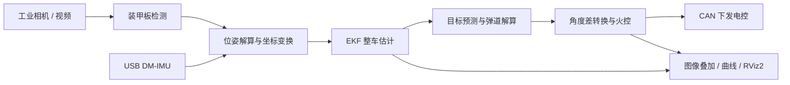

# RM27 · 珠海科技学院征途 Uprising 战队视觉自瞄

本项目由**珠海科技学院征途 Uprising 战队**基于 [同济大学 SuperPower 战队 `sp_vision_25`](https://github.com/TongjiSuperPower/sp_vision_25) 二次开发，围绕本队硬件完成通信、姿态输入、瞄准输出、火控与调试工具的适配，用于 RoboMaster 视觉自瞄的开发与调试。

本仓库沿用原项目的 C++17 模块化框架，包含装甲板识别、位姿解算、EKF 整车状态估计、运动预测和弹道补偿，并保留原版的 MPC 规划、能量机关和全向感知等模块。当前主要改动集中在步兵入口 [`src/standard.cpp`](src/standard.cpp)。

**开源来源声明：本项目由珠海科技学院征途 Uprising 战队在 `TongjiSuperPower/sp_vision_25` 基础上进行二次开发与维护。原有视觉框架、自瞄理论及相关算法的贡献归原作者；本队在此基础上的新增与修改见下文。感谢原项目作者及相关开源社区。**

[改进说明](#相对原版的改进) · [编译与运行](#编译与运行) · [标定](#相机与手眼标定) · [可视化](#可视化与调试) · [开源引用](#开源引用与许可证)

## 相对原版的改进

改动以 Git 历史中的共同祖先 [`604e119`](https://github.com/TongjiSuperPower/sp_vision_25/commit/604e11943b7dc3a8b466cce6d72079e5d271b2b7) 为对照。以下描述对应当前实现，不代表命中率或运行性能的量化提升。

| 方向 | 本仓库的新增或调整 | 对应实现 |
| --- | --- | --- |
| 达妙 CAN 适配 | 抽象统一 CAN 接口，在 SocketCAN 之外增加 DM-USB2FDCAN SDK 后端，支持设备选择；增加禁用 CAN、仅发送和发送频率上限配置 | [`io/can_backend.hpp`](io/can_backend.hpp)、[`io/damiao_can.cpp`](io/damiao_can.cpp)、[`io/cboard.cpp`](io/cboard.cpp) |
| USB IMU 姿态链路 | 调整达妙 IMU 驱动，解析 USB 虚拟串口数据，优先使用模块四元数，兼容两种 CRC 算法和欧拉角回退；通过姿态队列与插值匹配图像时刻 | [`io/dm_imu/`](io/dm_imu/)、[`src/standard.cpp`](src/standard.cpp) |
| 坐标系与输出适配 | 按 IMU 安装旋转调整云台到世界系的变换；增加去畸变像点到角度增量的接口；在 `standard` 中将瞄准结果转换为电控需要的角度差，支持枪口偏移补偿 | [`tasks/auto_aim/solver.cpp`](tasks/auto_aim/solver.cpp)、[`src/standard.cpp`](src/standard.cpp) |
| 瞄准模式 | 增加 `absolute` / `delta` 两种计算路径。前者使用世界系预测与弹道结果结合当前姿态求角度差，后者使用预测像点计算 yaw 差值，并从当前检测点计算弹道 pitch | [`src/standard.cpp`](src/standard.cpp)、[`configs/demo.yaml`](configs/demo.yaml) |
| 火控调整 | 在角度制下检查指令稳定性，增加 pitch 稳定性条件、可配置的连续满足帧数，以及云台反馈/角度误差判定路径；将弹速回退值改为可配置 | [`tasks/auto_aim/shooter.cpp`](tasks/auto_aim/shooter.cpp)、[`tasks/auto_aim/aimer.cpp`](tasks/auto_aim/aimer.cpp) |
| 视频输入 | 增加 `camera_name: video`，可配置播放帧率与循环播放；录制回放入口增加 `.mp4`、`.mov` 扩展名尝试 | [`io/video/`](io/video/)、[`io/camera.cpp`](io/camera.cpp)、[`tests/auto_aim_test.cpp`](tests/auto_aim_test.cpp) |
| 二维调试 | 在 `standard -d` 中显示下发角度、IMU 姿态、跟踪状态、目标信息与火控状态；增加上一帧预测与当前检测的 yaw/pitch 对比曲线，并统一检测框的数据来源 | [`src/standard.cpp`](src/standard.cpp)、[`tools/curve_plot.cpp`](tools/curve_plot.cpp) |
| RViz2 可视化 | 增加 UDP JSON 到 ROS2 MarkerArray/TF 的桥接节点，可查看整车估计、装甲板、瞄准点、自身姿态和弹道示意；提供启动脚本与 RViz 配置 | [`src/rviz_bridge.cpp`](src/rviz_bridge.cpp)、[`scripts/`](scripts/) |
| 棋盘格标定 | 新增内参、手眼分开采集与计算的流程，支持采集覆盖提示、自动收图、静止判定、相机/IMU 相对转角不一致样本剔除及 YAML 结果输出 | [`calib_chessboard/`](calib_chessboard/) |
| 构建兼容 | 增加视频调试构建选项、按平台选择硬件源文件，以及 Eigen/fmt/OpenMP 的兼容处理，方便 Linux 部署与 macOS 视频调试 | [`CMakeLists.txt`](CMakeLists.txt)、[`io/CMakeLists.txt`](io/CMakeLists.txt)、[`tools/`](tools/) |

装甲板检测模型、EKF 整车估计、弹道迭代求解和 TinyMPC 规划等能力来自原项目。本仓库保留这些模块；上述改动不表示所有机器人入口都已完成相同适配。

## 工作流程



图中为当前 `standard` 的主要数据流。普通自瞄核心不要求 ROS2；RViz2 桥接与哨兵导航通信按需启用。

## 编译与运行

### 1. 环境与依赖

实机部署以 **Ubuntu 22.04、C++17、CMake ≥ 3.16.3** 为起点。当前提供 Linux x86_64/ARM64 工业相机库目录；达妙 CAN 库需另外核对架构。macOS 相关代码用于视频调试，工业相机与真实 CAN 后端仅在 Linux 构建。

Ubuntu 基础依赖：

```bash
sudo apt update
sudo apt install -y \
  git build-essential cmake pkg-config \
  libopencv-dev libfmt-dev libeigen3-dev libspdlog-dev \
  libyaml-cpp-dev libusb-1.0-0-dev nlohmann-json3-dev \
  libceres-dev can-utils
```

还需准备：

| 依赖 | 用途与说明 |
| --- | --- |
| [OpenVINO](https://docs.openvino.ai/) | 神经网络推理，必需；模型文件位于 `assets/` |
| [Ceres Solver](https://ceres-solver.org/) | 能量机关模块使用，当前顶层构建也会查找该依赖 |
| 相机厂商 SDK | Linux 构建链接海康 MVS 与迈德威视库；仓库已有部分头文件与 `.so`，使用硬件时仍需完成厂商驱动、权限及运行环境配置 |
| 达妙 DM-USB2FDCAN SDK | 默认 Linux 构建会链接；仓库自带 `io/damiao/lib/linux/libdm_device.so` 为 x86_64，ARM64 需提供 `io/damiao/lib/linux_arm64/libdm_device.so` |
| ROS2 / RViz2（可选） | 用于三维可视化；哨兵导航相关目标还需要 `sp_msgs` |

**OpenVINO 路径：** 当前顶层 `CMakeLists.txt` 写有 `2025.4.0` 路径，`tasks/auto_aim/CMakeLists.txt` 和 `tasks/auto_buff/CMakeLists.txt` 写有 `2024.6.0` 路径。编译前应将这三处 `OpenVINO_DIR` 统一为本机安装目录下的 `runtime/cmake`，并加载对应 `setupvars.sh`。若这些写死的目录不存在，也可通过 `CMAKE_PREFIX_PATH` 指向实际安装目录供 CMake 查找；不要混用不同版本的头文件与运行库。

### 2. 获取与编译

以下使用当前开发的 `linux` 分支：

```bash
git clone --branch linux https://github.com/abing-coder/RM27.git
cd RM27

# 完成上面的依赖与 OpenVINO 路径配置后执行
cmake -S . -B build -DVIDEO_ONLY=OFF
cmake --build build -j"$(nproc)"
```

只做本地视频调试、无需达妙 CAN SDK 时，可以使用：

```bash
cmake -S . -B build -DVIDEO_ONLY=ON
cmake --build build --target auto_aim_test -j"$(nproc)"
```

若使用 `CMAKE_PREFIX_PATH` 查找 OpenVINO，可按实际安装位置配置，例如：

```bash
cmake -S . -B build -DVIDEO_ONLY=ON \
  -DCMAKE_PREFIX_PATH=/opt/intel/openvino_2026.4.1/runtime/cmake
```

`VIDEO_ONLY=ON` 的作用是跳过达妙 CAN SDK，不会自动关闭程序中的硬件初始化，也不会移除 OpenVINO、Ceres 或 Linux 相机库的构建依赖。切回达妙 CAN 实机运行时，需重新配置 `-DVIDEO_ONLY=OFF` 并编译。

以下命令均从仓库根目录执行，模型、配置和视频的相对路径以当前工作目录为基准。

### 3. 无硬件离线回放

仓库提供配套的 `assets/demo/demo.avi` 与 `assets/demo/demo.txt`：

```bash
./build/auto_aim_test assets/demo/demo -c=configs/demo.yaml
```

输入参数是**不带扩展名的路径前缀**。程序尝试 `.avi`、`.mp4`、`.mov` 视频，同时读取同名前缀的 `.txt`；文本每行格式为：

```text
时间戳（秒） w x y z
```

该入口不初始化相机、CAN 或 USB IMU，适合回放检查检测、跟踪、预测与重投影。按 `q` 退出，可用 `-s=起始帧`、`-e=结束帧` 限定范围。

**请使用与视频逐帧配套的时间戳/姿态文本。** 当前 `auto_aim_test` 未校验文本读取是否成功，任意视频或仅有视频扩展名支持并不代表能直接完成可靠回放。其开火标记也采用独立的调试逻辑，不等同于 `standard` 的 `Shooter` 判定。

### 4. 实机运行

建议从包含本仓库新增字段的 [`configs/demo.yaml`](configs/demo.yaml) 复制一份机器人配置，再修改设备和标定参数：

```bash
cp configs/demo.yaml configs/local.yaml
# 修改 configs/local.yaml 后运行
./build/standard configs/local.yaml -d
```

重点核对以下配置：

| 配置项 | 含义 |
| --- | --- |
| `enemy_color` | 敌方颜色；颜色过滤会影响是否进入跟踪 |
| `camera_name` | `hikrobot`、`mindvision` 或 `video`；当前通用 `io::Camera` 没有 `usb` 分支 |
| `vid_pid`、`exposure_ms`、`gain` / `gamma` | 工业相机设备与曝光参数，按厂商类型填写 |
| `camera_matrix`、`distort_coeffs` | 当前相机、镜头和分辨率对应的内参与畸变 |
| `R_camera2gimbal`、`t_camera2gimbal` | 相机到云台的外参；平移单位为米 |
| `R_gimbal2imubody` | 云台到 IMU 机体系的安装旋转 |
| `dm_imu_port` | USB IMU 串口，例如 `/dev/ttyACM0` |
| `aim_mode` | `absolute` 或 `delta`，两种模式向电控下发的都是角度差 |
| `gun_yaw_offset`、`gun_pitch_offset` | 枪口偏移补偿，单位为度 |
| `can_interface` | `damiao:1` 表示第一个达妙设备；或填写 `can0` 等 SocketCAN 接口名 |
| `can_disabled` | `true` 时禁止 CAN 通信，适合只观察视觉结果 |
| `can_send_only` | `true` 时不等待电控回传姿态，适合姿态由 USB IMU 提供的单向下发链路 |
| `can_send_hz` | 发送频率上限；`0` 或缺失时随调用频率发送，不是独立定频线程 |
| `send_canid` | 电控接收视觉指令的 CAN ID，必须与下位机一致 |
| `bullet_speed` | 弹速回传低于 `14 m/s` 时使用的回退值，默认 `22 m/s` |
| `auto_fire`、`fire_ready_consecutive_frames` | 自动开火开关与连续满足开火条件的帧数 |

`standard` 始终从 USB DM-IMU 获取姿态；`aim_mode: delta` 或 `can_disabled: true` 均不会跳过 USB IMU 初始化。串口需有访问权限，IMU 需持续输出有效姿态。Ubuntu 可将用户加入 `dialout` 组后重新登录：

```bash
sudo usermod -aG dialout "$USER"
```

USB IMU 与相机可分别检查：

```bash
./build/dm_test /dev/ttyACM0
./build/camera_test -c=configs/local.yaml -d
```

普通 USB 摄像头保留在 `usbcamera_test` 等独立工具中；棋盘格标定工具另有 `camera_name: opencv` 输入方式，不能直接套用到 `standard` 的通用相机配置。

### 5. CAN 下发协议

当前 [`CBoard::send`](io/cboard.cpp) 使用 8 字节数据，每个字段为 16 位大端整数：

| 字节 | 字段 | 编码 |
| --- | --- | --- |
| 0–1 | yaw 角度差 | `int16_t(角度 × 10)`，右转为正 |
| 2–3 | pitch 角度差 | `int16_t(角度 × 10)`，抬头为正 |
| 4–5 | control | `0` / `1`，是否存在有效控制指令 |
| 6–7 | shoot | `0` / `1`，是否请求开火 |

例如 yaw `+1.2°`、pitch `-0.5°` 编码为 `12`、`-5`；无有效目标时 `standard` 下发零角度差并关闭开火。通信双方应按这里的单位、符号和字节序对接。

**该协议已不同于原版，原版入口不能直接套用当前电控协议。** `standard_mpc`、`auto_aim_debug_mpc` 等保留入口仍有各自的串口/反馈与角度约定，使用前需分别核对。

## 相机与手眼标定

新增的 [`calib_chessboard`](calib_chessboard/) 工具将内参和手眼分开采集，避免两类标定对棋盘移动方式的要求互相干扰。

先修改 [`calib_chessboard/config.yaml`](calib_chessboard/config.yaml)：填写棋盘格**内角点**行列数、相邻角点间距（毫米）、相机参数及 IMU 安装旋转。换相机、镜头、采集分辨率或安装位置后，应重新完成对应标定。

```bash
# 第一步：只标内参；不读 IMU，移动棋盘以覆盖不同位置、距离与倾角
./calib_chessboard/run.sh intra

# 第二步：只标手眼；固定棋盘，转动云台，姿态来自 USB IMU
./calib_chessboard/run.sh hand
```

采集窗口会提示覆盖情况；开启自动采集后，满足相应条件即可保存。`s` 手动保存，满足采集要求后按 `c` 开始计算，`q` 结束采集。手眼采集应在云台停稳后进行，并包含足够的 yaw/pitch 姿态变化。

| 内容 | 默认位置 |
| --- | --- |
| 内参采集图片 | `calib_chessboard/data_intrinsics/` |
| 手眼图片与姿态 | `calib_chessboard/data_handeye/`，图片与同名 `.txt` 四元数配对 |
| 内参结果 | `calib_chessboard/output/intrinsics.yaml` |
| 手眼结果 | `calib_chessboard/output/handeye.yaml` |

仓库中的采集样例用于参考。新设备标定应使用本机重新采集的数据；开始前可将样例目录移到其他位置备份，避免混用不同安装条件的样本。

`hand` 模式优先读取上述 `intrinsics.yaml`，缺失时会尝试 `configs/demo.yaml` 和标定配置中的内参。因此，应先生成当前设备的内参结果再做手眼。`intra` / `hand` 模式会清空自动导出目标设置，**结果不会自动覆盖机器人配置**，需要把以下四项复制到实际运行的 YAML：

```text
camera_matrix
distort_coeffs
R_camera2gimbal
t_camera2gimbal
```

原版圆点标定程序仍位于 [`calibration/`](calibration/)，使用说明见 [`docs/handeye_guide.md`](docs/handeye_guide.md)。圆点标定与新增棋盘格流程使用不同的标定板和配置字段。

## 可视化与调试

### 图像与曲线

```bash
./build/standard configs/local.yaml -d
```

界面显示检测框、整车估计重投影、预测瞄准点、下发指令、USB IMU 姿态和火控连续帧计数。下方曲线中，红色表示上一帧跟踪结果外推到当前帧的角度，绿色表示当前帧检测解算的角度，用于观察一步预测误差。

若希望用视频替代工业相机，在运行配置中修改：

```yaml
camera_name: video
video_path: assets/demo/demo.avi
video_fps: 0        # 0 使用视频自身帧率，正数覆盖播放帧率
video_loop: true
can_disabled: true
```

这种方式仍需连接 USB IMU，使用的是实时 IMU 姿态，不会读取视频同名 `.txt`。需要复现录制时姿态时，请使用前面的 `auto_aim_test` 配对回放入口。

### RViz2 三维显示

Ubuntu 22.04 可使用 ROS2 Humble。安装 ROS2 后补齐 RViz2 与桥接依赖，并在加载 ROS2 环境后重新配置构建：

```bash
sudo apt install -y \
  ros-humble-rviz2 ros-humble-ament-cmake ros-humble-rclcpp \
  ros-humble-std-msgs ros-humble-geometry-msgs \
  ros-humble-visualization-msgs ros-humble-tf2-ros

source /opt/ros/humble/setup.bash
cmake -S . -B build
cmake --build build --target rviz_bridge standard -j"$(nproc)"
./scripts/run_rviz.sh configs/local.yaml
```

`standard` 通过本机 UDP `9871` 发送 JSON，`rviz_bridge` 转换后发布 `/auto_aim/markers` 和 TF。桥接仅依赖 ROS2 官方消息包，无需 `sp_msgs`；未安装 ROS2 时，普通自瞄核心仍可编译运行。可视化中的弹道为示意，不代表实弹轨迹测量。

已单独运行 `standard` 时，可以只启动桥接与 RViz2：

```bash
NO_STANDARD=1 ./scripts/run_rviz.sh
```

## 目录结构

```text
RM27/
├── assets/             模型、视频及其他素材
├── configs/            机器人与算法 YAML 配置
├── io/                 相机、视频、CAN、USB IMU、串口及 ROS2 通信
├── tasks/
│   ├── auto_aim/        检测、解算、EKF、瞄准、火控和规划器
│   ├── auto_buff/       能量机关相关模块
│   └── omniperception/ 全向感知相关模块
├── src/                各机器人主程序与 RViz2 桥接
├── tools/              数学、弹道、日志、曲线与录制工具
├── calibration/        原版圆点标定工具
├── calib_chessboard/   新增棋盘格标定工具及采集样例
├── scripts/            RViz2 配置与启动脚本
├── tests/              各模块测试与调试程序
├── docs/               补充说明
├── CMakeLists.txt
└── LICENSE
```

`tests/` 中包含依赖硬件、图形窗口或录制数据的独立程序，不是统一的无硬件自动化测试集。

## 当前使用边界

- 当前新增硬件链路和调试界面主要围绕 `standard`；其他兵种、MPC 和能量机关入口需要按设备分别验证。
- `configs/demo.yaml` 中的内外参、枪口偏移与 IMU 安装矩阵属于已有设备示例，不能直接视为新机器人的标定结果。
- `small_gyro_fire_yaw_thresh`、`fire_window_yaw_thresh_deg`、`fire_window_pitch_thresh_deg` 当前虽被读取，但未用于 `Shooter::shoot` 的开火判断；不能通过调这些值启用预测过枪线开火。
- macOS 包含视频调试所需的兼容处理，不提供本仓库 Linux 工业相机/CAN SDK 的实机能力。
- 本仓库尚未在本文提供同条件命中率、击杀时间或帧率对照数据。原项目 README 中的比赛成绩属于原项目，不能作为本版本的测试结论。

遇到问题可在 [Issues](https://github.com/abing-coder/RM27/issues) 中附上系统、硬件、配置、复现命令和日志。提交算法修改时，建议提供可复现数据及相同条件下的对比结果。

## 开源引用与许可证

### 直接上游

本项目基于同济大学 SuperPower 战队 2025 赛季视觉框架开发：

- 原项目：[TongjiSuperPower/sp_vision_25](https://github.com/TongjiSuperPower/sp_vision_25)
- 原项目介绍与理论：[上游 README](https://github.com/TongjiSuperPower/sp_vision_25/blob/main/readme.md)
- 原项目许可证：[MIT License](https://github.com/TongjiSuperPower/sp_vision_25/blob/main/LICENSE)

本仓库保留原作者的版权声明与 [MIT 许可证正文](LICENSE)，项目代码沿用 MIT 许可。使用和再分发时请保留相应版权与许可文本；第三方代码、模型、素材及厂商 SDK 按各自许可处理。

### 随上游沿用的代码与相关依赖

| 项目 | 在本仓库中的用途 | 来源或许可说明 |
| --- | --- | --- |
| [TinyMPC](https://github.com/TinyMPC/TinyMPC) | MPC 规划器求解，代码位于 `tasks/auto_aim/planner/tinympc/`，沿用自上游 | [项目许可证](https://github.com/TinyMPC/TinyMPC/blob/main/LICENSE) |
| [wjwwood/serial](https://github.com/wjwwood/serial) | 串口库，代码位于 `io/serial/`，沿用自上游 | 本地源码头部保留 MIT 等对应版权/许可声明 |
| [OpenVINO](https://github.com/openvinotoolkit/openvino)、[OpenCV](https://github.com/opencv/opencv)、[Eigen](https://gitlab.com/libeigen/eigen)、[Ceres Solver](https://github.com/ceres-solver/ceres-solver) | 推理、图像处理、线性代数与优化 | 外部依赖，遵循各项目对应版本许可证 |
| [fmt](https://github.com/fmtlib/fmt)、[spdlog](https://github.com/gabime/spdlog)、[yaml-cpp](https://github.com/jbeder/yaml-cpp)、[nlohmann/json](https://github.com/nlohmann/json) | 格式化、日志、配置与 JSON 数据 | 外部依赖，遵循各项目许可证 |
| [ROS2](https://github.com/ros2)、[RViz2](https://github.com/ros2/rviz) | 可选的导航通信与三维可视化 | 外部依赖，遵循相应软件包许可证 |

### 原项目列出的模型与算法参考

以下为上游 README 中列出的相关来源，在此保留致谢与引用关系；不表示本仓库直接集成了这些项目的完整代码：

1. 深圳大学 RobotPilots：[RM2024 赛季识别模型](https://bbs.robomaster.com/article/54091)。
2. 北京科技大学 Reborn：[RM2024 识别训练网络及推理代码开源](https://bbs.robomaster.com/article/9655)。
3. julyfun：[rm.cv.fans / Linear Modelled Top Detector](https://github.com/julyfun/rm.cv.fans)。
4. 陈君：[rm_vision](https://github.com/chenjunnn/rm_vision)。
5. Nguyen K., Schoedel S., Alavilli A., et al. *TinyMPC: Model-predictive control on resource-constrained microcontrollers*. ICRA, 2024.

`assets/` 中沿用的模型与素材应结合上游说明及原始发布来源确认使用条件，本仓库不将其声明为自行训练或自行创作。海康、迈德威视、达妙 SDK 的头文件与动态库属于厂商组件，本项目的 MIT 声明不改变这些组件的授权条件。
